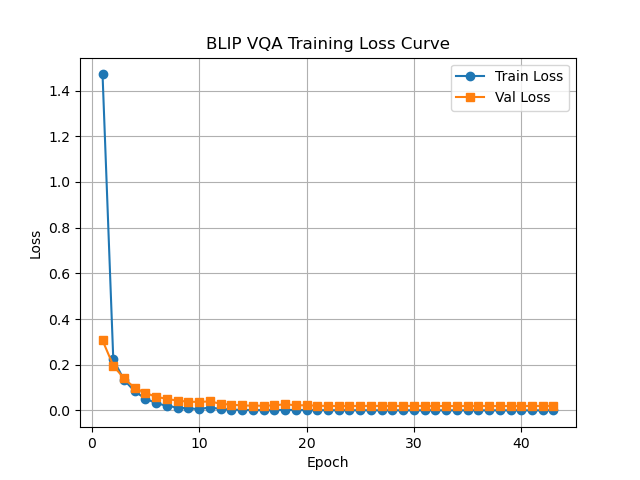
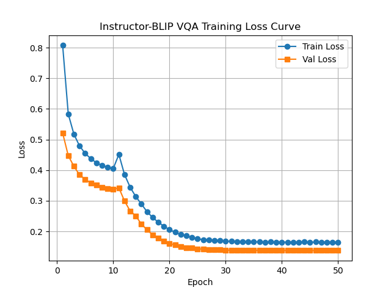
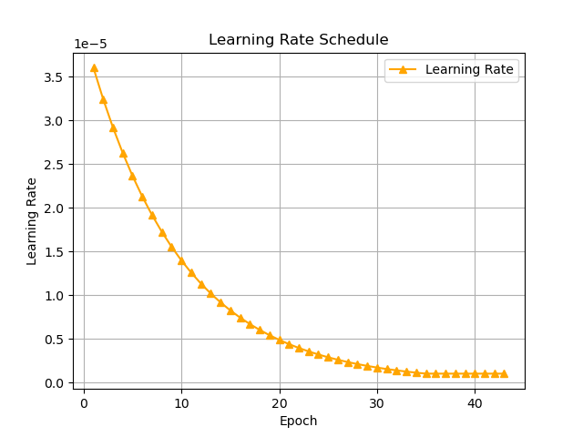
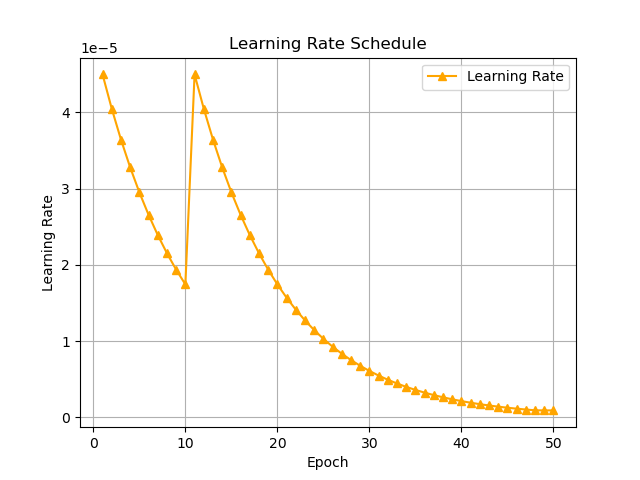

# ♻️ WasteAssistant: Language-Guided Vision-AI System for Intelligent Waste Segregation

[](https://www.python.org/downloads/)
[](https://pytorch.org/)
[](https://huggingface.co/)
[](LICENSE)

> **WasteAssistant** is a language-guided Vision-AI framework that combines Vision–Language Models (VLMs) with Multimodal Large Language Models (MLLMs) for visual question answering and intelligent waste segregation, aligned with India's **Solid Waste Management (SWM) Rules, 2016**.

---

## 📖 Overview

Efficient waste segregation is essential for sustainable urban management. Traditional waste classification systems often focus on visual recognition without considering the contextual information needed to guide appropriate disposal.

WasteAssistant addresses these challenges by:

- Introducing a Visual Question Answering (VQA) approach for waste identification and disposal guidance.
- Answering policy-oriented questions about waste classification, recycling, contamination, and disposal.
- Fine-tuning BLIP and InstructBLIP on the custom WasteVQA dataset.
- Comparing models trained using answer annotations generated by LLaVA-7B and Qwen2-VL-7B.
- Evaluating model performance on test data and a real-world waste video case study.

Example questions include:

- What type of waste item is shown in the image?
- Is this item recyclable under SWM Rules, 2016?
- Which colored bin should this item be disposed of in?
- Does this item require special handling?

---

## 🤗 Hugging Face Resources

Access the dataset, all four fine-tuned model repositories, and the associated research paper through Hugging Face.

### Research Paper

**WasteAssistant: Language-Guided Vision-AI System for Intelligent Waste Segregation**

[Read the research paper on Hugging Face](https://huggingface.co/papers/2607.10610)

### Dataset

**WasteVQA** is the regulation-aware Visual Question Answering dataset developed for waste identification, classification, and disposal guidance.

- **Dataset repository:** [KhushKataruka/WasteVQA](https://huggingface.co/datasets/KhushKataruka/WasteVQA)

### Fine-Tuned Model Checkpoints

The project evaluates BLIP and InstructBLIP models trained using answer annotations generated by LLaVA-7B and Qwen2-VL-7B.

| Model Variant | Hugging Face Repository |
|---|---|
| BLIP + LLaVA | [WasteAssistant-BLIP-LLaVA](https://huggingface.co/KhushKataruka/WasteAssistant-BLIP-LLaVA) |
| BLIP + Qwen2-VL | [WasteAssistant-BLIP-QWEN](https://huggingface.co/KhushKataruka/WasteAssistant-BLIP-QWEN) |
| InstructBLIP + LLaVA | [WasteAssistant-InstructBlip-LLaVA](https://huggingface.co/KhushKataruka/WasteAssistant-InstructBlip-LLaVA) |
| InstructBLIP + Qwen2-VL | [WasteAssistant-InstructBlip-QWEN](https://huggingface.co/KhushKataruka/WasteAssistant-InstructBlip-QWEN) |

Each model has a separate repository for independent discovery and downloading.

---

## 🏗️ Architecture

WasteAssistant uses three principal components:

1. **Image Encoder:** Extracts visual features from the input image.
2. **Image-Grounded Question Encoder:** Processes the question and aligns its representation with the image features.
3. **Answer Decoder:** Generates an answer conditioned on the visual and linguistic representations.

```text
             Input Image
                  |
                  v
             Image Encoder
                  |
                  v
            Visual Features
                  |
                  +------------------+
                                     |
Input Question                      |
       |                             |
       v                             |
 Question Encoder                    |
       |                             |
       +-------------+---------------+
                     |
                     v
              Cross-Attention
                     |
                     v
               Answer Decoder
                     |
                     v
              Generated Answer
```

### Models Evaluated

| Model | Approximate Parameters | Base Model | Vision Encoder | Answer Generator |
|---|---:|---|---|---|
| BLIP | 0.25B | VQA base | ViT-B/16 | LLaVA-7B |
| BLIP | 0.25B | VQA base | ViT-B/16 | Qwen2-VL-7B |
| InstructBLIP | 3B | Flan-T5-XL | ViT-L/14 | LLaVA-7B |
| InstructBLIP | 3B | Flan-T5-XL | ViT-L/14 | Qwen2-VL-7B |

LLaVA and Qwen2-VL are used to generate training answer annotations. The fine-tuned BLIP and InstructBLIP checkpoints are the models evaluated for the WasteAssistant task.

---

## 📊 WasteVQA Dataset

WasteVQA is designed to support visual question answering for waste identification, classification, and disposal guidance.

| Statistic | Value |
|---|---:|
| Total images, including augmentations | 6,000+ |
| Total question-answer pairs | 13,500 |
| Waste categories | 21 |
| Average Q&A pairs per image | Approximately 2.3 |
| Annotation formats | JSON and CSV |
| Source datasets | TrashNet, TrashBox, BDwaste |

### Waste Categories

The dataset covers waste categories including:

- Biodegradable waste
- Plastic waste
- Glass waste
- Metal waste
- Paper and cardboard
- Hazardous waste
- Electronic waste
- Sanitary waste
- Domestic hazardous waste
- Composite waste
- Inert waste

The dataset supports questions about material identification, contamination, recycling, compostability, disposal preparation, bin selection, environmental impact, and decomposition.

**Access the dataset:** [WasteVQA on Hugging Face](https://huggingface.co/datasets/KhushKataruka/WasteVQA)

---

## 📈 Results

### Main Results: WasteVQA Test Set

| Model | LLaVA BLEU | LLaVA BERTScore | Qwen2-VL BLEU | Qwen2-VL BERTScore |
|---|---:|---:|---:|---:|
| **BLIP** | **0.8291** | **0.9273** | **0.8785** | **0.9517** |
| InstructBLIP | 0.6345 | 0.7612 | 0.6798 | 0.7935 |

**Best reported result:** BLIP trained with Qwen2-VL-generated answers achieves BLEU = 0.8785 and BERTScore = 0.9517.

### Case Study: Real-World Waste Video Analysis

| Metric | BLIP (LLaVA) | InstructBLIP (LLaVA) | BLIP (Qwen) | InstructBLIP (Qwen) |
|---|---:|---:|---:|---:|
| Precision | 59.05 | 63.86 | 57.20 | 60.92 |
| F1-Score | 54.62 | 59.28 | 53.65 | 52.25 |
| BERTScore | 50.23 | 54.56 | 54.84 | 48.96 |

### Training Curves

<p align="center">
  
  
</p>

<p align="center">
  <em>Left: BLIP training and validation loss. Right: InstructBLIP training and validation loss.</em>
</p>

<p align="center">
  
  
</p>

<p align="center">
  <em>Left: BLIP learning rate schedule. Right: InstructBLIP learning rate schedule.</em>
</p>

---

## 🚀 How to Run

### Prerequisites

Install the required Python dependencies:

```bash
pip install torch torchvision transformers pillow tqdm nltk bert-score albumentations scikit-learn pandas matplotlib opencv-python python-dotenv
```

A compatible GPU is recommended for model training and for running large multimodal answer-generation models.

### Environment Setup

1. Copy the example environment file:

   ```bash
   cp .env.example .env
   ```

2. Add your Hugging Face access token to `.env` if required by your selected model or data-generation pipeline.

3. Obtain a token from [Hugging Face Settings](https://huggingface.co/settings/tokens).

**Security:** Never commit `.env` files or expose access tokens in your source code.

---

## 🔄 Full Training Pipeline

The complete workflow consists of six steps:

```text
Step 1                 Step 2              Step 3
create_data.py  --->  data_filtering.py -> create_augmented_dataset.py
(GT generation)       (CSV to JSON)        (Augmentation and splitting)
                                                   |
                                                   v
Step 6                 Step 5              Step 4
save_plots.py   <---  testing.py     <---  vqa.py
(Visualization)       (Evaluation)        (Training)
```

### Step 1: Generate Ground-Truth Answers

The pipeline uses a multimodal LLM to generate question-answer pairs for images in the dataset.

**LLaVA-based generation:**

```bash
cd Blip/
python create_data.py
```

**Qwen2-VL-based generation:**

```bash
cd Blip_Qwen/
python create_data.py
```

**Output:** `vqa_generated.csv`

The LLaVA-based pipeline uses Ollama. The Qwen2-VL-based pipeline uses Hugging Face and requires the relevant model access and computational resources.

The corresponding InstructBLIP directories also contain generation scripts for their respective workflows.

### Step 2: Filter and Structure the Dataset

```bash
python data_filtering.py
```

**Input:** `vqa_generated.csv`  
**Output:** `vqa_final.json`

### Step 3: Augment and Split the Dataset

```bash
python create_augmented_dataset.py
```

Expected outputs:

- `augmented_images/`
- `split_jsons/train.json`
- `split_jsons/val.json`
- `split_jsons/test.json`

### Step 4: Train the Models

**BLIP + LLaVA:**

```bash
cd Blip/
python vqa.py
```

**BLIP + Qwen2-VL:**

```bash
cd Blip_Qwen/
python vqa.py
```

**InstructBLIP + LLaVA:**

```bash
cd InstructBlip/
python vqa.py
```

**InstructBLIP + Qwen2-VL:**

```bash
cd Blip_Instruct_Qwen/
python vqa.py
```

The checkpoints are saved in the corresponding model output directories.

### Step 5: Evaluate on the Test Set

Run the evaluation script from the appropriate model directory:

```bash
python testing.py
```

The evaluation scripts generate prediction files and metrics such as BLEU and BERTScore.

### Step 6: Generate Training Plots

```bash
python save_plots.py
```

---

## 🎥 Real-World Video Evaluation

The video evaluation pipeline assesses model predictions on frames extracted from a real-world waste-disposal video.

### Step 1: Generate Video Ground Truth

Place the extracted frames in the configured frame directory and update the data-generation configuration to point to those frames.

For a Qwen2-VL-based workflow:

```bash
cd Blip_Qwen/
python create_data.py
```

Update `Config.DATASET_ROOT` and `Config.OUTPUT_CSV` in the script as required for the video case study.

### Step 2: Run VQA on Video Frames

```bash
python video_evaluation.py
```

**Output:** `frame_vqa_results.csv`

### Step 3: Compute Evaluation Metrics

```bash
python evaluate_res.py
```

The evaluation compares model predictions with generated ground-truth answers and calculates the configured metrics.

---

## 🔧 Training Configuration

| Hyperparameter | Value |
|---|---|
| Optimizer | AdamW |
| Maximum epochs | 50, with early stopping |
| Learning rate | 4 × 10⁻⁵ (BLIP), 5 × 10⁻⁵ (InstructBLIP) |
| Learning-rate scheduler | ExponentialLR, γ = 0.9 |
| Weight decay | 5 × 10⁻⁶ (BLIP), 7 × 10⁻⁵ (InstructBLIP) |
| Batch size | 32 |
| Vision encoder | Frozen for the first 10 epochs |
| Mixed precision | FP16 (BLIP), BF16 (InstructBLIP) |
| Random seed | 42 |

---

## 📂 Directory Structure

The repository is organized into separate directories for each model and answer-generation variant.

```text
FoundationModel/
├── README.md
├── .env.example
├── split_jsons/
├── augmented_images/
├── Blip/
│   ├── create_data.py
│   ├── data_filtering.py
│   ├── create_augmented_dataset.py
│   ├── vqa.py
│   ├── testing.py
│   ├── save_plots.py
│   └── blip_model_all_layers/
├── Blip_Qwen/
│   ├── create_data.py
│   ├── vqa.py
│   ├── testing.py
│   └── blip_model_all_layers/
├── InstructBlip/
│   ├── create_data.py
│   ├── vqa.py
│   ├── testing.py
│   └── instructor_blip_freeze_unfreeze/
└── Blip_Instruct_Qwen/
    ├── create_data.py
    ├── vqa.py
    ├── testing.py
    └── instructor_blip_freeze_unfreeze/
```

### Results Location

| Result | File |
|---|---|
| BLIP + LLaVA scores | `Blip/vqa_eval_results.csv` |
| BLIP + Qwen2-VL scores | `Blip_Qwen/vqa_eval_results.csv` |
| InstructBLIP + LLaVA scores | `InstructBlip/instructblip_vqa_eval_results.csv` |
| InstructBLIP + Qwen2-VL scores | `Blip_Instruct_Qwen/instructblip_vqa_eval_results.csv` |
| BLIP loss curve | `Blip/blip_model_all_layers/loss_curve.png` |
| InstructBLIP loss curve | `InstructBlip/instructor_blip_freeze_unfreeze/loss_curve.png` |
| BLIP learning-rate schedule | `Blip/blip_model_all_layers/lr_schedule.png` |
| InstructBLIP learning-rate schedule | `InstructBlip/instructor_blip_freeze_unfreeze/lr_schedule.png` |

---

## 🔬 Evaluation Metrics

### BLEU-4

Sentence-level BLEU-4 measures overlap between generated answers and reference answers. Smoothing is used to improve numerical stability for short answers.

### BERTScore

BERTScore measures contextual semantic similarity between generated answers and reference answers.

### Case Study Metrics

- **Token Precision:** Proportion of predicted tokens that occur in the reference.
- **Token F1-Score:** Harmonic mean of token precision and recall.
- **BERTScore:** Contextual semantic similarity.

---

## 🔁 Reproducibility

The training pipeline uses a random seed of `42` across Python, NumPy, PyTorch, and data splitting.

Reproducing the reported results requires the same dataset version, checkpoint, configuration, evaluation scripts, and compatible software dependencies. GPU kernels and library versions may introduce small differences.

The published checkpoints are available from the [Hugging Face model repositories](#-hugging-face-resources).

---

## 📝 Citation

If you use this work, please cite the associated research paper:

**Paper:** [WasteAssistant — arXiv:2607.10610](https://huggingface.co/papers/2607.10610)

```bibtex
@article{wasteassistant2025,
  title={WasteAssistant: Language-Guided Vision-AI System for Intelligent Waste Segregation},
  author={Khush and Harshit and Anuja and Murari Mandal and Praveen},
  year={2025}
}
```

Dataset: [KhushKataruka/WasteVQA](https://huggingface.co/datasets/KhushKataruka/WasteVQA)

---

## 📄 License

This project is released under the [MIT License](LICENSE).

---

## 🙏 Acknowledgments

- Salesforce for the BLIP and InstructBLIP model families.
- The creators of the TrashNet, TrashBox, and BDwaste datasets.
- India's Ministry of Environment, Forest and Climate Change for the Solid Waste Management Rules, 2016.
